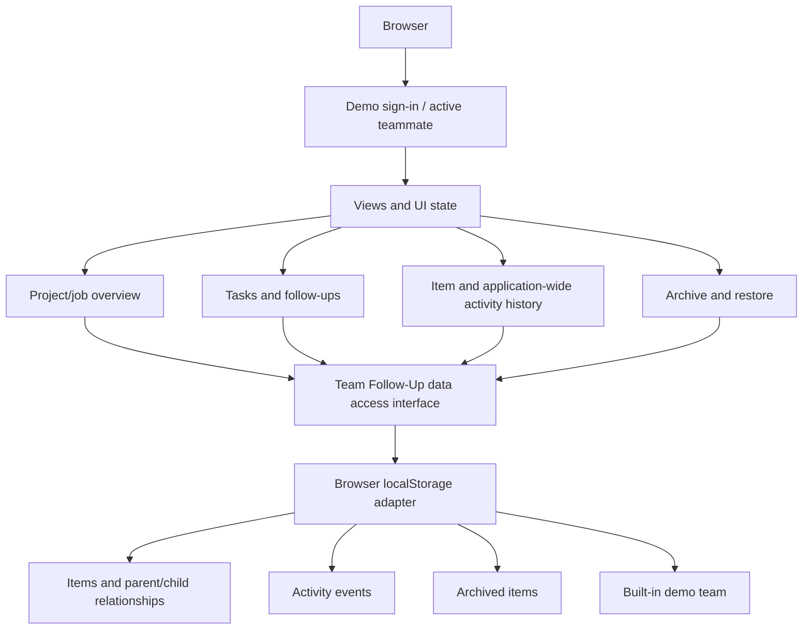

# Project Guide — Team Follow-Up Application

This guide explains how to access the demo, run the application, understand its architecture, work on the code, validate changes, and publish the static demo. It describes the current public project as it is today: a self-contained browser app with demo authentication and browser-local persistence. For the full application reference, see [docs/DOCUMENTATION.md](docs/DOCUMENTATION.md).

## 1. Demo URL and access

The target demo URL is **https://retzed.github.io/Team_Follow-Up/**. It becomes available after completing the one-time GitHub Pages setup in Section 7. Until Pages is enabled, run the project locally as described in Section 5.

The public site is for evaluation and presentation. Do not enter real personal, confidential, or company-sensitive information.

### Built-in demo users

Use one of the six standard usernames (English or Arabic alias), or use `root` for the protected demo root identity. Standard users accept a non-empty password until they set one in the account page; `root` starts with password `root@1234`.

| Team member | English username | Arabic username | User ID | Display label |
|---|---|---|---|---|
| Marwa | `Marwa` | `مروة` | `u1` | Team Leader |
| Zyad | `Zyad` | `زياد` | `u2` | AWS Engineer |
| Nadine | `Nadine` | `نادين` | `u3` | AWS Engineer |
| Omar | `Omar` | `عمر` | `u4` | AWS Engineer |
| Haneen | `Haneen` | `حنين` | `u5` | AWS Engineer |
| Dina | `Dina` | `دينا` | `u6` | AWS Engineer |
| Root | `root` | — | `root` | Protected system administrator |

This is intentionally not production authentication. The root demo password and any changed demo passwords are verified using salted PBKDF2-HMAC-SHA-256 records; the root record uses 210,000 iterations. Standard demo users retain the legacy non-empty-password behavior until they set a password. All records remain within browser-controlled storage, and the public client cannot enforce a trusted security boundary.

### Account page and profile behavior

The signed-in page opens on **Assigned Items**. The account hub contains **Profile**, **Assigned Items**, **Pinned Items**, and **Search**. The profile display name is distinct from the sign-in username; users may optionally save Arabic display-name and label translations. The icon selector displays names and previews the chosen glyph before save. Theme and language take effect immediately and are saved independently of Profile **Save changes**. The Projects workspace retains its own Search sidebar, expanded by default and controlled by a floating expand/collapse button.

### Demo data lifetime

- Workspaces are saved in local browser storage for this site.
- Data is shared between demo usernames **within the same browser profile and site origin** because they are viewing the same local workspace.
- Different browsers, devices, profiles, and private/incognito windows have separate copies. There is no cloud synchronization.
- The current login is stored in the active tab's session storage, so it normally remains through refreshes in that tab but is not a persistent real identity.
- Use **Reset demo data** to restore the starter dataset in the current browser.

## 2. Product concepts and hierarchy

The app separates top-level work containers from child items.

- **Project:** top-level. It may contain tasks and follow-ups.
- **Job:** top-level. It may contain follow-ups only.
- **Task:** must belong to a project and may contain follow-ups.
- **Follow-up:** must belong to a project, job, or task.

A project/job cannot be created as a child. The UI dynamically displays the applicable parent type in context and prevents invalid parent/type combinations.


Every item can hold a name, description, creator metadata, assignee, priority, status, and applicable dates. Updating fields or status should produce activity-history entries. Priority can be raised to the maximum using the important/star control. Deleted items go to the archive and may be restored when the required hierarchy is available.

## 3. Application architecture

The browser app is currently served as static HTML. The full responsive UI, styling, rendering routines, and client modules live in `index.html`.



### Main layers

1. **Presentation layer:** HTML forms, responsive layouts, filters, popups, cards, history tables, and mobile controls.
2. **Application logic:** selected item, creation/edit flows, filtering, hierarchy rules, state rendering, archive/restore selection, and activity formatting.
3. **Data access layer:** the `TeamFollowUpDataAPI` interface exposes asynchronous operations so view logic does not directly manipulate every storage record.
4. **Local adapter:** the current built-in adapter stores work items, team profiles, archive records, and activity events in `localStorage`. Index-like fields support list, hierarchy, assignment, and history queries.
5. **Demo session:** `sessionStorage` remembers the active demo user for the current tab. It is not a secure authentication mechanism.

The public repository intentionally contains no server deployment stack. A future server can implement equivalent operations behind the data access boundary; that implementation should not require the UI to know which host or database is used.

## 4. Repository layout

- `index.html` — complete application and browser-local data adapter.
- `package.json` — commands for local validation and building a static artifact.
- `scripts/build.mjs` — creates `dist/index.html` with the public demo settings and `.nojekyll`.
- `scripts/check-syntax.mjs` — parses executable inline JavaScript.
- `scripts/test-*.mjs` — regression checks for local data operations, history, archive, filtering, language handling, layout, and demo build.
- `docs/ARCHITECTURE.md` — architecture and data flow.
- `.github/workflows/pages.yml` — tests the app and publishes the static site on pushes to `main`.

Generated output in `dist/` is not source-of-truth; update `index.html` and rebuild it instead.

## 5. Run the project on your computer

### Option A — Python's built-in web server

1. Install Python 3 if it is not already available.
2. Open a terminal in the repository root (the folder containing `index.html`).
3. Run:

   ```bash
   python -m http.server 8000
   ```

4. Open [http://localhost:8000](http://localhost:8000).
5. Sign in with a built-in username and any non-empty password.

Stop the server with `Ctrl+C`.

### Option B — Open the file directly

You can double-click `index.html` to try it. A local HTTP server is recommended because browsers handle storage and origin semantics more predictably on localhost.

## 6. Run tests and build the demo

Install Node.js 20+ to run the test/build scripts. No third-party NPM packages are required at this time.

From the project root:

```bash
npm test
npm run build
```

The test suite checks JavaScript syntax and key data/UI behavior, including create/edit/status/assignment flows, archive and selective restore, history event integrity, search and bilingual rendering, popup behavior, and public demo configuration.

Build output:

```text
dist/
├── index.html
└── .nojekyll
```

The workflow builds this folder and uploads it as a GitHub Pages artifact. It does not publish repository source files as the website root.

## 7. GitHub Pages publishing

The public website is published from `main` by the GitHub Actions workflow in `.github/workflows/pages.yml`.

### Initial setup (one time)

1. Open the repository
2. Select **Settings → Pages**.
3. Under **Build and deployment**, set **Source** to **GitHub Actions**.
4. Push a commit to `main`, or open **Actions** and run the workflow manually.
5. Open the newest **Test and deploy demo** run. Wait for both build and deployment jobs to finish successfully.
6. The first publication may take a short time to become available.

### Ongoing updates

After the initial setup, every push to `main` runs the frontend regression tests, builds `dist/`, and publishes it through GitHub Pages if tests pass. Pull requests run validation but do not deploy the website.

If the build succeeds but deployment reports that Pages is not enabled, recheck **Settings → Pages → Source → GitHub Actions**, save it, and rerun the workflow. The workflow uses GitHub's Pages deployment artifact; it does not push compiled output to a separate source branch.

## 8. How to add a feature safely

1. Create a short-lived feature branch from `main`.
2. Locate the relevant UI handler/renderer in `index.html` and inspect the associated regression tests in `scripts/`.
3. Keep data writes behind `TeamFollowUpDataAPI` where possible. Avoid scattering direct storage modifications through UI event handlers.
4. Respect the hierarchy rules and preserve activity-history behavior when changing data.
5. Add or update a regression test for behavior changes.
6. Run `npm test` and `npm run build`.
7. Commit and push the branch, open a pull request, check CI, and merge only after the tests pass.
8. Verify the demo after the merge to `main`.

For large changes to the one-file application, keep modifications targeted and test the affected UI path in a normal browser as well as running the automated suite.

### Responsiveness and event-handling rules

Modal controls live inside the workspace DOM, so their click handler must stop propagation before processing an action. Do not allow a modal action to bubble into the workspace's delegated handler; otherwise a create, edit, close, delete, or restore action could run twice.

Keep hierarchy queries index-backed and keep the shared `allDescendants()` helper iterative and cycle-safe. Separate hierarchy renderers must maintain their own visited-ID guards and avoid unbounded recursion. Dialogs should use direct-child checks when direct relationships are sufficient; avoid walking an entire subtree to populate a simple selector. For date sorting, use the indexed per-item Activity entries instead of searching a Project/Job timeline for each comparator call.

The existing regression coverage checks those constraints, including synthetic 15,000-level and cyclic hierarchies. After changing a modal, hierarchy rule, or sort/filter implementation, run:

```bash
npm test
npm run build
```

## 9. Data model concepts

The local adapter maintains four logical collections:

- **Work items:** IDs, type, name/description, parent/root IDs, timestamps, status, priority, creator and assignee metadata, and index-like sort/search fields.
- **Activity events:** affected item, parent/root context, actor, timestamp, action, and fields required to search/filter the timeline.
- **User profiles:** the six built-in demo identities and display/role metadata.
- **Archive:** deleted work items with hierarchy and archive metadata so restore can validate parent relationships.

Activity events are a first-class history stream. Creation, edits, status changes, assignment changes, archive, and restore actions should retain their history behavior. For bulk/hierarchy operations, avoid misleading duplicate events.

These collections are local browser structures, not tables in a remote database.

## 10. Language and visual behavior

- English and Arabic are supported.
- User-entered text uses bidirectional direction detection to preserve mixed-script names.
- Interface-language alignment and text direction are separate concerns.
- Light/dark theme and responsive breakpoints should continue working across activity dialogs, search/assignment panels, and archive views.
- App labels/actions should be translated; user-provided names/descriptions are data and should not be auto-translated.

## 11. Security and scope boundaries

This is a presentation demo, not a production system.

- Sign-in accepts any non-empty password for known demo names. It does not verify identity.
- Data is readable and editable in the browser and can be reset or modified by the visitor.
- Do not use real personal data, employee-sensitive notes, customer data, passwords, or secrets.
- Browser storage is not a database backup and does not synchronize users.
- No server-side authorization or durable shared backend is included.
- Keep the public repository focused on the application, generic architecture, tests, and presentation documentation. Hosting/database implementation will be designed separately if shared persistence is needed.

## 12. Troubleshooting

**I cannot sign in.** Use one of the six usernames (English or Arabic) and ensure the password contains at least one character.

**My work disappeared on another device.** That is expected in local demo mode. Data is scoped to browser storage for this site origin.

**I want a clean sample workspace.** Use **Reset demo data**. It resets this browser's local copy only.

**A test fails after a UI change.** Read the assertion message in terminal output. Find the related test in `scripts/`, verify the intended behavior, and update the test only if requirements intentionally changed.

**The live site did not update.** Check the latest run in the repository's **Actions** tab. Deployment only occurs from `main` after the test/build job succeeds. Confirm Pages is configured to use GitHub Actions.

**I need shared multi-user data.** This is out of scope for the public demo. Introduce a provider-neutral API/service contract first, then implement and test the chosen server/database adapter separately.
