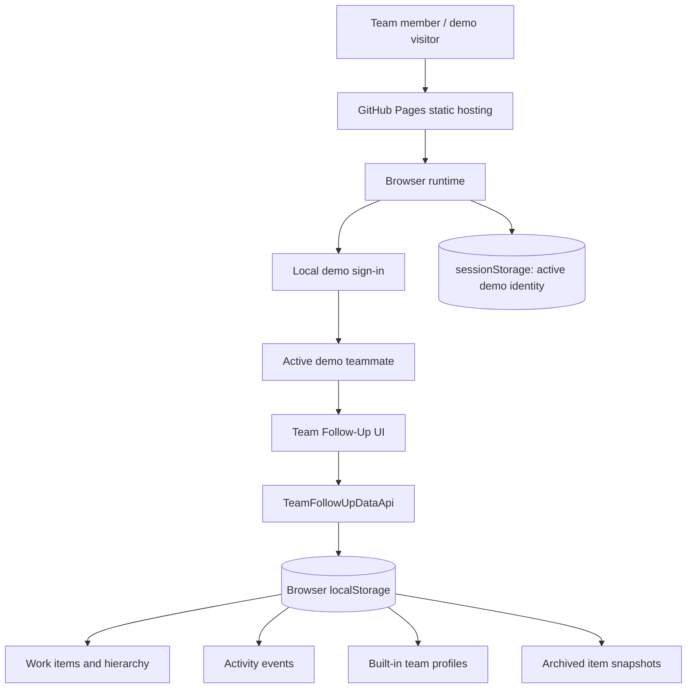
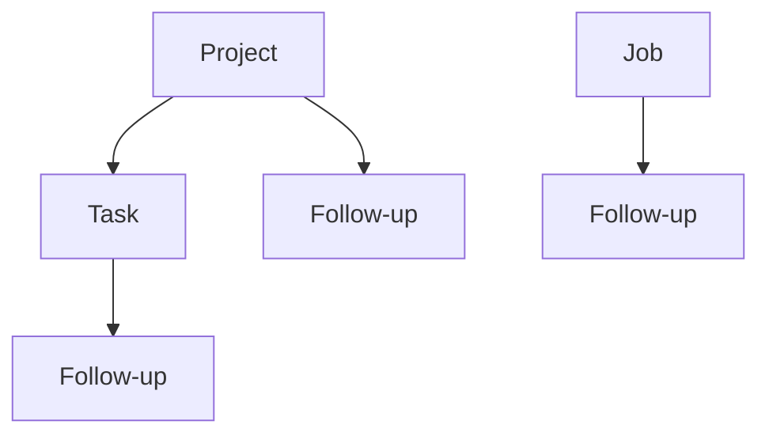

# Application Architecture

## Scope and system boundary

This repository is the **browser-local demonstration** of Team Follow-Up. It is a static site: GitHub Pages serves the HTML artifact, and application state lives in the visitor's browser. There is no application server, remote database, or shared multi-user workspace in this build.

The production-oriented AWS implementation is maintained separately in the [Team Follow-Up AWS Deployment repository](https://github.com/retzed/Team_Follow-Up_AWS-Deployment). That repository has a Cognito-authenticated API and DynamoDB persistence; its security and deployment topology must not be inferred from this local demo.

## System context



## Component responsibilities

The runtime is organized as a small set of script-level components inside `index.html`. This keeps the public demo self-contained and dependency-free while separating responsibilities through named functions and closure-scoped state.

| Component | Responsibility |
|---|---|
| Preference bootstrap | Detects supported browser language and color-scheme preferences before the page paints. Unsupported or indeterminate preferences fall back to English and dark mode. |
| Runtime configuration | Defines the public demo configuration. The build script replaces this block to force the built-in data mode and local demonstration sign-in. |
| Data-access adapter | Exposes asynchronous methods for bootstrap, users, top-level items, children, assignments, activity, archive, restore, and commits. |
| Sign-in gate | Establishes the demo identity in the active tab. It explains that sign-in is illustrative, not a security boundary. |
| Application controller | Owns current UI state, filtering, selection, rendering, dialogs, translations, activity refresh, and delegated event handlers. |
| Layout compatibility layer | Applies the sidebar-height and responsive fixes needed by the delivered static page. |
| Build and test scripts | Produce the GitHub Pages artifact and validate JavaScript syntax, data operations, activity behavior, UI behavior, and build settings. |

### Data-access boundary

The UI calls `window.TeamFollowUpDataApi` instead of treating storage records as the presentation model. Conversion helpers map persisted table-shaped records into the app's simpler item, event, archive, and user objects. Query and write helpers centralize filtering, pagination-like behavior, normalization, index-field maintenance, and activity-event merging.

In demo mode, the adapter stores logical collections in local browser storage. Index-like attributes emulate the access patterns expected by a future remote adapter; they are **not** DynamoDB tables and do not provide database consistency, authorization, or cross-device synchronization.

The UI module remains in one large HTML source file to preserve the simple static distribution model. Its internal responsibilities are separated into script blocks and functions, but the size of the controller and inline styles are a known maintainability trade-off. Any future file-level modularization should be incremental: preserve script execution order, the pre-authentication gate, the build configuration replacement, and the current regression-test contract.

## Domain model and hierarchy



- **Project** and **Job** are top-level items and cannot be created under another item.
- A **Project** may contain **Tasks** and direct **Follow-ups**.
- A **Job** may contain **Follow-ups** only.
- A **Task** belongs to a Project and may contain **Follow-ups**.
- A **Follow-up** is a leaf item and cannot contain children.

Items carry identifiers, type, name and description, creator and update metadata, assignment, status, priority, relevant dates, and hierarchy references. The adapter derives fields used to query by parent, workspace/root, assignment, or time. Archive records preserve root/parent metadata so the app can validate restore order and retain useful audit context.

The four logical collections are:

1. **Work items** — active Project, Job, Task, and Follow-up records.
2. **Activity events** — append-oriented records with item/root context, actor, action, and timestamp.
3. **User profiles** — built-in demo identities and display-role labels.
4. **Archive** — deleted item snapshots and hierarchy metadata.

## Data flow

### Startup

1. The earliest script sets document language, direction, and theme defaults to avoid an incorrect initial layout.
2. The demo runtime configuration selects the built-in adapter and local demo sign-in.
3. The sign-in gate resolves the active demo teammate; it does not authenticate a real account.
4. The adapter loads and normalizes the saved tables, migrates older local schema shapes when needed, and returns a UI snapshot.
5. The application controller initializes its indexes, selected workspace item, translations, and event handlers, then renders the UI.

### Mutation and activity history

1. A UI action requests a create, edit, status/assignment update, archive, or restore operation.
2. Hierarchy and field rules are applied before the data is committed.
3. Related activity events are normalized and merged by stable event identity to avoid duplicate audit rows.
4. The data-access layer saves the changed logical tables, and the UI refreshes affected lists and timelines.
5. A page reload reads the latest browser-local state when storage remains available.

The `esc()` helper is the central output-encoding boundary for text interpolated into HTML templates. Plain text should be assigned using `textContent` where markup is not needed. Storage failures are caught and logged; when persistent browser storage is unavailable, the demo can continue in memory, but those changes may not survive the current page session.

## Frontend responsiveness and interaction lifecycle

The rendered workspace and its modal host are nested in the same DOM subtree. The modal click delegate therefore owns modal actions and stops propagation before handling them; the outer workspace handler also ignores modal descendants as a defensive boundary. This avoids duplicate dispatch when the dialog closes or replaces its DOM during the event.

The hierarchy index maps item IDs and parent IDs to records/children. The shared `allDescendants()` helper used for validation/deletion uses iterative traversal with a visited-ID set rather than unbounded JavaScript recursion. Separate hierarchy renderers retain their own visited-ID guards. Modal type selectors use direct-child checks whenever that is sufficient, and stop once the answer is known.

The Activity index groups events by item and by root. Root-level timeline operations may use the root collection, while child-item date comparisons use the child's own indexed events. This avoids repeatedly scanning the entire root Activity collection during a sort. These are client-side implementation details and do not introduce a new storage entity or external service.

Regression tests cover the event-propagation boundary, cyclic and deep hierarchy input, and child timestamp lookup behavior. For code changes, the expected local validation is `npm test` followed by `npm run build`; GitHub Actions repeats the tests and publishes the built artifact to Pages.

## Persistence and isolation

- Workspaces persist in `localStorage` for the site's origin and browser profile.
- Demo sign-in state is kept in `sessionStorage` for the active tab.
- Demo usernames share the same workspace when used in the same browser profile because they are views of one local demonstration dataset.
- Other browsers, devices, profiles, and private windows have independent data.
- Clearing site storage or using **Reset demo data** removes or resets the local demonstration workspace.

These properties are acceptable only for a demo. Browser data can be inspected or changed by the visitor and must never be treated as authoritative or confidential.

## Security boundaries

- The public build intentionally uses the local demo adapter and does not require a backend endpoint.
- A username selects a demonstration identity; any non-empty password is accepted. This is **not authentication** and provides no account protection.
- No secrets or production credentials belong in the HTML, runtime configuration, sample data, tests, or GitHub Pages artifact.
- User-provided names, descriptions, and search terms are untrusted. Keep HTML interpolation escaped and prefer DOM text APIs.
- The demo's local state and client-side hierarchy checks are usability controls, not security enforcement.

For shared team use, the separate AWS implementation places identity and authorization at Cognito/API Gateway and enforces business rules, identity mapping, server-owned keys, and writes in Lambda. DynamoDB holds durable work-item, activity, user-profile, and archive records.

## Build and delivery

The demo's GitHub Actions workflow runs the Node.js test suite, generates `dist/index.html`, adds `dist/.nojekyll`, and publishes the static artifact through GitHub Pages when a validated commit reaches `main`. The build explicitly resets runtime configuration to the browser-local mode so the public demo cannot accidentally inherit AWS API settings.

Useful developer commands:

```bash
npm test
npm run build
```

The build does not need cloud credentials, an AWS account, a database server, or third-party npm packages.

## Account Search, navigation and responsive interaction contract

The account hub and workspace share the same item model but intentionally have separate navigation/filter state. My Account opens on Assigned Items; the top-bar username opens Profile. Account Search operates on top-level Projects/Jobs and matches item metadata plus associated creator, updater, owner, and assignee identities. Its type/status filters, date sort mode, inclusive From/To date bounds, user selector, and Clear action are client-side controls over the loaded top-level dataset. It does not turn child items into separate results.

Each Search result presents explicit Open in workspace, Activity history, and pin actions. Selecting a root switches the page state from account to workspace before rendering details. Selecting an assigned/pinned child resolves its root, waits for root hydration, expands its Task ancestor chain from the hydrated hierarchy, then scrolls the selected child into view. The sidebar collapse control must preserve the selected root and selected child; expansion restores the detail view after lazy loading.

Activity remains on-demand instead of being fetched for every account result. Item-history buttons use the existing item/root activity cache and query boundary. In the demo, that cache and all records are browser-local; in the AWS repo, cached GET responses improve performance but the authenticated API and DynamoDB remain authoritative.

For responsive layout, the account Search filter grid switches to two shrink-safe columns at widths up to 820 CSS pixels, with the query spanning the row. Input/select controls have bounded widths, result action buttons wrap, and the same structure must work in both English LTR and Arabic RTL. Inert result cards are not focusable; their explicit buttons provide keyboard access. These frontend changes add no data model, API, or persistence contract.

## Workspace Search sidebar lifecycle

The Search sidebar's `ui.sidebarCollapsed` flag is the source of truth for the workspace grid, the sidebar content's `hidden` state, and the floating toggle's `aria-expanded` state. Startup and navigation from Account enter the workspace with the sidebar collapsed. The toggle uses a dedicated state transition instead of invoking a broad translation pass when closing.

When the sidebar closes, the frontend clears any not-yet-fired top-level search timer and increments `sidebarQuerySequence`. `renderParentList()` checks the captured sequence both before and after asynchronous API work, preventing stale results from updating the closed sidebar. Opening uses the established in-memory list rendering and selected-root hydration logic. Resize events synchronize the current state but do not override it. This is a frontend lifecycle fix; it adds no API, storage, or deployment contract.

## Future evolution

The preferred extension point is the data-access interface, not direct storage manipulation in view handlers. A future backend adapter should preserve the same public item/event model and the user-visible hierarchy/activity behavior while moving validation, authorization, concurrency control, auditing, and shared persistence to a trusted server. That transition requires security and integration tests against the server implementation; changing a browser configuration flag alone does not make the demo production-ready.
